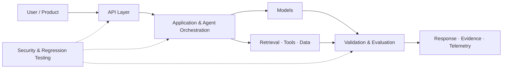

<!-- Abdul Rahman | GitHub Profile README -->

  

  <h1>Abdul Rahman</h1>
  <h3>AI Engineer · Generative AI & AI Agents · DevOps & Cloud Engineering</h3>

  

    
    
    
  

  
<b>Computer Science & IoT Graduate</b> · Hyderabad, India

  
<i>Building AI-powered applications and backend systems, while developing practical skills in DevOps, cloud infrastructure and automation.</i>

---

## 🧑‍💻 Profile Overview

I'm interested in building reliable software across **Generative AI, agentic systems, Python backend engineering, DevOps and cloud infrastructure**.

I value clear architecture, reproducible tests, practical engineering and software that other developers can run and inspect.

**Want the full picture?** My <a href="https://xatreus.github.io/abdul-rahman-portfolio/">portfolio website</a> brings together project walkthroughs, technical skills, certifications and current work.

## 🧭 Engineering Map

A conceptual map of the engineering areas I explore. Individual repositories implement different subsets of this architecture.

---

## 🚀 Selected Projects

  <h3>AI Engineering · Backend Systems · DevOps · Cloud & Reliability</h3>
  
These are selected portfolio projects. Visit my <a href="https://xatreus.github.io/abdul-rahman-portfolio/">website for project details, skills and the broader portfolio</a>.

### 01 · <a href="https://github.com/Xatreus/cognis">Cognis</a>
**AI Agent Evaluation & Security Regression Platform**

A platform for running repeatable quality and security evaluations against AI models and agent endpoints, inspecting failures and comparing measurable results.

Active portfolio project. Provides regression signals, not a security guarantee or certification.

### 02 · <a href="https://github.com/Xatreus/Aetheris">Aetheris</a>
**AI Production Reliability & Observability Platform**

An early-stage reliability engineering platform combining an application-side TypeScript OpenTelemetry SDK with a Python control plane.

Development baseline, not production-ready. Cloud manifests are starter scaffolding.

### 03 · <a href="https://github.com/Xatreus/NexPilot">NexPilot</a>
**AI Software Engineering & DevOps Assistant**

An engineering copilot prototype for structured software task planning and read-only analysis of public GitHub repositories.

Early prototype. Repository analysis uses metadata and file-tree signals; autonomous code editing and deployment are not implemented.

### 04 · <a href="https://github.com/Xatreus/report-explainer">Report Explainer</a>
**Local-First Document Intelligence & RAG Workspace**

A document workspace for PDF and TXT ingestion, evidence retrieval, source-grounded Q&A, report comparison and citations.

Local-first portfolio application. Review provider data policies before processing confidential documents.

### 05 · <a href="https://github.com/Xatreus/lead-reviver-">Lead Reviver</a>
**Evidence-Aware AI Lead Management & Follow-Up Assistant**

An AI-assisted workspace for prioritizing inactive leads and preparing context-aware follow-up drafts for human review.

Drafts are saved for human review and are never sent automatically. Authentication, tenant isolation and production hardening remain outstanding.

### 06 · <a href="https://github.com/Xatreus/invoice-buddy">Invoice Buddy</a>
**AI-Powered Invoice Intelligence API**

A Python API for extracting structured information from PDF invoices and answering questions about invoice records using database queries and retrieval.

Designed for local use and portfolio demonstration. Do not use sensitive production financial data without a security and privacy review.

### 📚 <a href="https://github.com/Xatreus/python-for-ai">Python for AI</a>
A learning archive of Python fundamentals and small data-oriented exercises.

---

## 🧰 Technologies I Work With

My portfolio website contains the expanded skills list, technical areas and project-by-project context. Technologies span hands-on implementation, project-specific use and ongoing learning; not every technology is used in every repository.

---

## 🔐 Security Knowledge & Practice

I have studied web, API and AI application security through hands-on labs and project work.

<b>Explore security areas</b>

- Web vulnerabilities: SQL injection, XSS, SSTI, IDOR and path traversal.
- Server-side and API security: SSRF, OS command injection, file-upload vulnerabilities and API testing.
- AI application security: prompt injection, tool misuse and LLM application attack surfaces.
- Security foundations: authentication, authorization, input validation and OWASP concepts.

For more detail on my technical skills and practical work, see the <a href="https://xatreus.github.io/abdul-rahman-portfolio/">portfolio website</a>.

---

## 🎓 Certifications

---

## 📈 GitHub Activity

  

---

## 🎯 What I'm Exploring Next

- Building dependable CI/CD workflows and automated quality gates.
- Deepening practical Kubernetes, Terraform and cloud deployment skills.
- Improving observability, monitoring and production troubleshooting.
- Building AI applications and agent workflows on strong backend foundations.

## 🤝 Connect

  
  
  
    
  <i>Build reliable systems. Automate delivery. Keep learning.</i>

