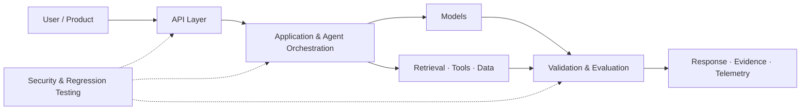

<!-- Abdul Rahman | GitHub Profile README -->

  

  <h1>Abdul Rahman</h1>
  <h3>AI Engineer · Generative AI & AI Agents · DevOps & Cloud Engineering</h3>

  

    
    
  

  
<b>Computer Science & IoT Graduate</b> · Hyderabad, India

  
<i>Building AI-powered applications and backend systems, with a focus on reliable engineering, automation and cloud technologies.</i>

---

## 🧑‍💻 About Me

I'm interested in building useful, reliable software across **Generative AI, agentic systems, Python backend engineering, DevOps and cloud infrastructure**.

I enjoy turning ideas into working applications, designing clear system architecture and continuously improving the quality, security and reliability of what I build.

## 🧭 Engineering Map

A conceptual view of the engineering areas I explore. Each project implements a different part of this picture.

---

## 🚀 Featured Projects

### 01 · <a href="https://github.com/Xatreus/Aetheris">Aetheris</a>
**AI Production Reliability & Observability Platform**

Aetheris explores how to make AI-powered applications more observable and reliable. It combines an application-side **TypeScript OpenTelemetry SDK** with a **Python control plane** to collect signals, evaluate reliability policies and support incident investigation.

- TypeScript SDK for application telemetry, traces and metrics over OTLP/HTTP.
- FastAPI control plane with typed reliability events and deterministic policies.
- Release evaluation gates with pass, warn and block outcomes.
- Evidence-preserving incident reports and SLO / error-budget evaluation.
- PostgreSQL persistence path with SQLite as the local test default.
- Docker Compose, Kubernetes and Terraform deployment scaffolding.

**Engineering focus:** OpenTelemetry · TypeScript · FastAPI · reliability policies · SLOs · platform engineering

Development baseline, not production-ready. Cloud manifests are starter scaffolding and have not been validated in a live cloud account.

---

### 02 · <a href="https://github.com/Xatreus/cognis">Cognis</a>
**AI Agent Evaluation & Security Regression Platform**

Cognis helps developers test AI models and agent endpoints through repeatable evaluation cases. It makes it easier to inspect failures, measure behavior and track quality and security regressions as systems change.

- Deterministic evaluation cases with assertions, pass rates and latency metrics.
- Baseline prompt-injection and response-level security regression probes.
- Adapters for compatible model APIs and existing HTTP-agent endpoints.
- JSON and Markdown reports, FastAPI API and local dashboard.
- SQLite evaluation history with optional PostgreSQL configuration.

**Engineering focus:** AI evaluation · security testing · adapters · API contracts · regression testing · reproducibility

Active portfolio project. It provides useful regression signals, not a security guarantee or certification; coverage and deployment hardening remain ongoing.

---

### Want to explore more?

I've built other projects across AI applications, RAG, backend development and automation. **Visit my <a href="https://xatreus.github.io/abdul-rahman-portfolio/">portfolio website</a> to discover more of my work and explore my broader technical skill set.**

---

## 🧰 Technologies

These represent technologies used across my projects and areas of ongoing learning; not every tool is used in every repository.

---

## 🔐 Security Knowledge

I have explored web, API and AI application security through hands-on labs and project work.

<b>View security topics</b>

- **Web:** SQL injection, XSS, SSTI, IDOR, path traversal and file-upload vulnerabilities.
- **Server & API:** SSRF, OS command injection, API testing, authentication and authorization.
- **AI security:** Prompt injection, tool misuse and LLM application attack surfaces.
- **Foundations:** Input validation and OWASP security concepts.

---

## 🎓 Certifications

---

## 📈 GitHub Activity

  

---

## 🤝 Connect

  
  
    
  <i>Build reliable systems. Automate delivery. Keep learning.</i>

