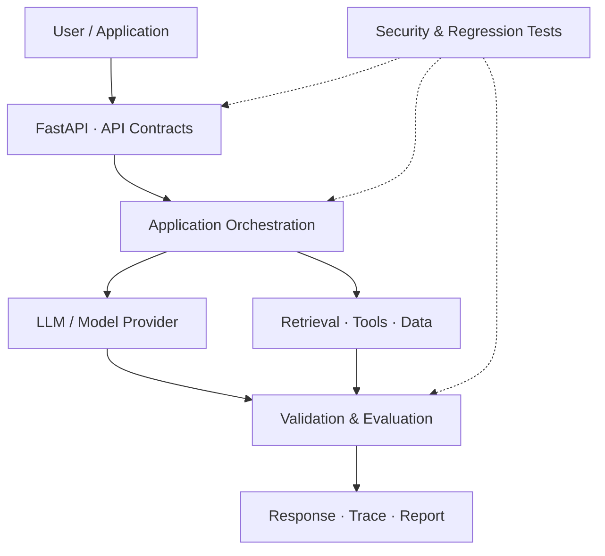

<!--
  Abdul Rahman | GitHub Profile
  Built with GitHub-flavoured Markdown, HTML details, Mermaid and Shields.io.
-->

  

  <h1>Hi, I'm Abdul Rahman 👋</h1>
  <h3>GenAI Engineering · AI Agents · AI Application Security</h3>

  

    
    
    
  

  
<b>Computer Science & IoT Graduate</b> · Hyderabad, India

  
<i>I build Python-based AI applications and explore how to make LLM-powered systems useful, testable, observable and secure.</i>

---

## 🧭 About Me

I'm interested in the engineering behind reliable AI products — from backend APIs and retrieval pipelines to agent workflows, evaluation and application security.

My current focus is on:

- **GenAI applications:** LLM integration, RAG, embeddings and tool/function calling.
- **Agent engineering:** task orchestration, typed tool contracts, workflows and reliable execution.
- **AI quality & security:** evaluation harnesses, regression testing, prompt-injection probes and API security.
- **Backend engineering:** Python, FastAPI, REST APIs, persistence, testing and maintainable architecture.

I care about the parts beyond a successful demo: clear boundaries, useful failure modes, reproducible tests and honest documentation.

## 🗺️ Engineering Focus

| AI Application Engineering | Agent Systems | AI Security |
|:---:|:---:|:---:|
| RAG · Embeddings · LLM APIs | Tool calling · Orchestration | Prompt injection · LLM testing |
| Document intelligence | Typed tasks · Async workflows | API security · Threat modeling |
| Evaluation · Grounding | Service boundaries · Observability | Security regression checks |

### How I think about an AI application

Conceptual view of the engineering concerns I work with — not a claim that every project implements every component.

---

## 🚀 Featured Projects

A selection of projects where I'm applying AI engineering, backend development and security concepts.

<b>01 · Cognis — AI Agent Evaluation & Security</b> Active development

 

A platform for running quality evaluations and security-regression checks against AI agents and model endpoints.

**What it does**
- Runs deterministic evaluation cases and records assertions, pass rates and latency.
- Includes baseline probes for prompt injection and related response-level security regressions.
- Connects to compatible model APIs and existing HTTP-agent endpoints through adapters.
- Produces JSON and Markdown reports, with a FastAPI API and local dashboard.
- Stores local evaluation history in SQLite, with optional PostgreSQL configuration.

**Engineering themes:** evaluation design · adapter boundaries · API contracts · security regression testing · reproducibility

> Cognis provides regression signals, not a guarantee of security or a production security certification. Adversarial coverage and deployment hardening remain ongoing work.

<b>02 · Invoice Buddy — AI Invoice Intelligence</b>

 

A Python and FastAPI application for extracting structured data from PDF invoices and answering questions about invoice records.

**What it does**
- Extracts structured invoice fields from PDFs using an LLM.
- Combines SQL-backed queries with RAG over invoice-document text.
- Uses tool-calling workflows to answer questions grounded in invoice data.
- Includes invoice lookup, spending summaries, duplicate checks and anomaly-reporting modules.
- Provides REST endpoints, API documentation and automated tests.

**Engineering themes:** document processing · LLM integration · retrieval · persistence · data validation · backend API design

> A personal engineering project intended for local use and demonstration. Review security, privacy and operational controls before using sensitive financial data or deploying publicly.

<b>03 · NexPilot Mini — Agent Engineering Prototype</b>

 

An experimental Python prototype exploring the foundations of a repository and documentation assistant.

- Pydantic models for typed tasks and task results.
- Asynchronous service orchestration and structured logging.
- Explicit service boundaries and custom exceptions.
- A starting point for validated repository inspection, documentation retrieval and tool contracts.

**Engineering themes:** async Python · typed interfaces · task orchestration · error handling · maintainable architecture

> This is an early scaffold: repository analysis and documentation retrieval are currently placeholder services, not a functioning autonomous coding agent.

---

## 🧰 Technology & Tools

I organize my stack by the engineering problems I'm working to solve, rather than treating every tool as an equal level of expertise.

| Domain | Technologies & concepts |
|---|---|
| **Languages** | Python, SQL |
| **AI / GenAI** | LLM APIs, RAG, embeddings, vector search, tool/function calling, agent workflows |
| **Backend** | FastAPI, REST APIs, Pydantic, SQLAlchemy |
| **Data & storage** | PostgreSQL, SQLite, ChromaDB, document processing |
| **Testing & quality** | pytest, evaluation metrics, regression testing, validation |
| **AI & application security** | Prompt-injection testing, LLM security, API testing, OWASP concepts |
| **Web security** | SQL injection, XSS, IDOR, SSRF, SSTI, path traversal, file-upload flaws, OS command injection |
| **Developer tools** | Git, GitHub, VS Code, Linux, Docker / Docker Compose |

  
  
  
  
  
  
  
  

Skills reflect a mix of hands-on project implementation, practical study and ongoing learning; depth varies by topic.

---

## 🔐 Security Learning & Practice

I have studied and practiced common web and API vulnerability classes through hands-on labs and security testing.

<b>View areas explored</b>

- **Injection:** SQL injection, OS command injection, server-side template injection (SSTI)
- **Browser-side:** reflected XSS, DOM-based XSS
- **Access control:** IDOR and authorization weaknesses
- **Server-side requests & files:** SSRF, path traversal, file-upload vulnerabilities
- **API security:** authentication, authorization, input validation and API testing
- **AI security:** prompt injection, tool misuse and LLM application attack surfaces

---

## 🎓 Certifications

| Certification | Issuer |
|---|---|
| [Oracle Cloud Infrastructure Certified AI Foundations Associate](https://catalog-education.oracle.com/pls/certview/sharebadge?id=FFF3BB90ADA78034EB70717DB0EE92C2640D9AC4F3572540C55C171B53200A20) | Oracle |
| [Oracle Agentic AI Certified Foundations Associate](https://catalog-education.oracle.com/pls/certview/sharebadge?id=D5F89B27F403077F3625D83FB1F6940A54DA55BFD8CFD0B1586F8D0AC7580E58) | Oracle |

---

## 📚 Currently Exploring

- Designing agent workflows with clear tool contracts and failure handling.
- Improving RAG quality, retrieval evaluation and grounded responses.
- Building repeatable AI evaluation and security regression suites.
- Strengthening software architecture, testing and deployment practices.

## 🤝 Let's Connect

I'm open to connecting with engineers and teams working on **GenAI engineering, AI agent development, Python backend systems and AI application security**.

  
  

    
  <i>Build thoughtfully. Test relentlessly. Secure by design.</i>

