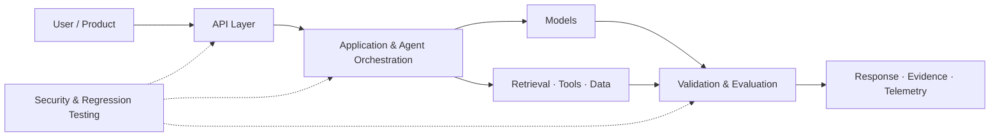

<!-- Abdul Rahman | GitHub Profile README -->

  

  <h1>Abdul Rahman</h1>
  <h3>AI & Backend Engineer · DevOps & Cloud Enthusiast</h3>

  

    
    
  

  
<b>Computer Science & IoT Graduate</b> · Hyderabad, India

  
<i>Building AI-powered applications and backend systems, while developing practical skills in DevOps, cloud infrastructure and automation.</i>

---

## 🧑‍💻 Profile Overview

I'm interested in building and operating reliable software: from Python backend services and AI-powered applications to CI/CD pipelines, cloud infrastructure, containers and observability.

My work and learning currently center on four areas:

| Focus | What I'm building knowledge in |
|---|---|
| **Generative AI** | LLM integration, RAG, embeddings, hybrid retrieval and grounded responses |
| **Agentic systems** | Tool calling, task orchestration, typed interfaces and bounded agent workflows |
| **Backend engineering** | Python, FastAPI, REST APIs, async programming, persistence and system design |
| **DevOps & Cloud** | Linux, Docker, CI/CD, GitHub Actions, Kubernetes, Terraform, AWS and Azure |
| **Reliability & Security** | OpenTelemetry, monitoring, SLOs, testing, API security and application guardrails |

I value clear architecture, reproducible tests, explicit limitations and software that can be run and inspected by other developers.

## 🧭 Engineering Map

A conceptual map of the engineering areas I explore. Individual repositories implement different subsets of this architecture.

---

## 🚀 Selected Projects

  <h3>AI Engineering · Backend Systems · DevOps · Cloud & Reliability</h3>
  
Explore the repositories below for implementation details, setup instructions, architecture and current limitations.

### 01 · <a href="https://github.com/Xatreus/cognis">Cognis</a>
**AI Agent Evaluation & Security Regression Platform**

Connect an AI model or agent endpoint, run repeatable quality and security cases, inspect individual failures and compare measurable results.

- Deterministic evaluation cases with assertions, pass rates and latency metrics.
- Baseline prompt-injection and response-level security regression probes.
- Adapters for compatible model APIs and existing HTTP-agent endpoints.
- JSON and Markdown reports, FastAPI API and local dashboard.
- SQLite evaluation history with optional PostgreSQL configuration.

**Core engineering:** evaluation design · adapters · API contracts · regression testing · reproducibility

Active portfolio project. It provides regression signals, not a security guarantee or certification; coverage and deployment hardening remain ongoing.

---

### 02 · <a href="https://github.com/Xatreus/Aetheris">Aetheris</a>
**AI Production Reliability & Observability Platform**

An early-stage reliability engineering platform combining an application-side TypeScript OpenTelemetry SDK with a Python control plane.

- TypeScript SDK for application telemetry, traces and metrics over OTLP/HTTP.
- FastAPI control plane with typed reliability events and deterministic policies.
- Release evaluation gates with pass / warn / block outcomes.
- Evidence-preserving incident investigation reports and SLO / error-budget evaluation.
- PostgreSQL persistence path with SQLite as the local test default.
- Docker Compose, Kubernetes and Terraform deployment scaffolding.

**Core engineering:** OpenTelemetry · TypeScript SDKs · FastAPI · reliability policies · SLOs · platform engineering

Development baseline, not production-ready. Cloud manifests are starter scaffolding and have not been validated in a live cloud account.

---

### 03 · <a href="https://github.com/Xatreus/NexPilot">NexPilot</a>
**AI Software Engineering & DevOps Assistant**

An engineering copilot prototype that turns software tasks into structured plans and inspects the delivery foundations of public GitHub repositories.

- Task planning across inspect, design, implement, test and deliver stages.
- Optional OpenRouter-compatible model assistance with deterministic fallback.
- Read-only repository intelligence for docs, tests, CI, dependencies and deployment signals.
- FastAPI backend, responsive dashboard and CLI.
- SQLAlchemy + SQLite activity history and Pydantic contracts.

**Core engineering:** AI-assisted planning · GitHub API integration · FastAPI · async HTTP · CLI · typed contracts

Early prototype. Repository checks inspect metadata and file-tree signals; they do not prove code quality, test success or deployment health. Autonomous code editing and deployment actions are not implemented.

---

### 04 · <a href="https://github.com/Xatreus/report-explainer">Report Explainer</a>
**Local-First Document Intelligence & RAG Workspace**

A document workspace for exploring PDF and TXT reports, retrieving evidence, comparing findings and asking questions about source material.

- PDF/TXT ingestion with page-aware chunking and optional OCR.
- Hybrid retrieval combining local semantic embeddings and lexical search.
- Evidence-grounded Q&A with source passages and page-aware citations.
- Multi-report comparison, extracted metrics, entities and risk dashboards.
- Bounded read-only report analyst workflow.
- Streamlit UI with SQLite by default; optional PostgreSQL + pgvector and Redis/RQ paths.
- Provider-agnostic model selection through an OpenAI-compatible API configuration.

**Core engineering:** RAG · hybrid search · document processing · citations · retrieval evaluation · agent workflows

Local-first portfolio application. External model calls are optional; review provider data policies before processing confidential documents.

---

### 05 · <a href="https://github.com/Xatreus/lead-reviver-">Lead Reviver</a>
**Evidence-Aware AI Lead Management & Follow-Up Assistant**

An AI-assisted workspace that helps sales teams prioritize inactive leads and prepare context-aware follow-up drafts for human review.

- Lead management, search, status filtering and CSV import/export.
- Explainable heuristic revival scoring based on recency, due dates, deal value and pipeline stage.
- Gemini-powered email, SMS and LinkedIn draft generation with configurable tone and goal.
- RAG knowledge base for approved product information and sales playbooks.
- PostgreSQL + pgvector semantic retrieval, with SQLite local-development fallback.
- Consent guardrails prevent draft generation for opted-out and do-not-contact leads.

**Core engineering:** FastAPI · PostgreSQL · pgvector · RAG · embeddings · human-in-the-loop AI

Drafts are saved for human review and are never sent automatically. Authentication, tenant isolation and production hardening remain outstanding.

---

### 06 · <a href="https://github.com/Xatreus/invoice-buddy">Invoice Buddy</a>
**AI-Powered Invoice Intelligence API**

A Python API that extracts structured information from PDF invoices and answers questions about invoice records using database queries and retrieval.

- PDF invoice ingestion and LLM-based extraction of invoice fields and line items.
- Structured persistence and filtering with SQLAlchemy and SQLite.
- Tool-calling agent for invoice questions rather than relying on model-generated financial facts.
- Invoice lookup, spending summaries, vendor history and overdue-invoice queries.
- RAG over invoice-document content and API endpoints for application workflows.

**Core engineering:** Python · FastAPI · SQLAlchemy · LLM extraction · RAG · tool calling

Designed for local use and portfolio demonstration. Do not use sensitive production financial data without a security and privacy review.

---

## 📚 Learning Repository

### <a href="https://github.com/Xatreus/python-for-ai">Python for AI</a>
**Python Learning Notes & Mini Projects**

A learning archive covering Python fundamentals and small data-oriented exercises, including weather-data analysis with pandas and CSV-based sales calculations.

This is a learning repository rather than a polished application; some practice files are intentionally exploratory or incomplete.

---

## 🧰 Technology Stack

**Languages & Backend**

**AI · Data · Quality**

| Area | Technologies & concepts |
|---|---|
| **Languages** | Python, SQL, TypeScript (SDK development) |
| **AI / GenAI** | LLM APIs, RAG, embeddings, vector search, hybrid retrieval, tool/function calling |
| **Agent engineering** | Agent workflows, adapters, orchestration, bounded tool use, evaluation |
| **Backend** | FastAPI, REST APIs, Pydantic, SQLAlchemy, Uvicorn, asynchronous programming, microservices |
| **Data & storage** | PostgreSQL, SQLite, pgvector, ChromaDB |
| **DevOps & Cloud** | Linux, Docker, Docker Compose, GitHub Actions, CI/CD, Kubernetes, Terraform, AWS, Azure, cloud-native deployment, infrastructure as code |
| **MLOps & Observability** | LLMOps, Langfuse (foundational), OpenTelemetry, monitoring, SLOs, model/agent evaluation |
| **Testing & Security** | pytest, Ruff, API/integration testing, secrets management, API security, OWASP concepts |
| **Developer tooling** | Git, GitHub, VS Code, async Python, HTTPX |

This stack spans hands-on implementation, project-specific use and ongoing learning; not every technology is used in every repository.

---

## 🔐 Security Knowledge & Practice

I have studied common web, API and AI application security topics through hands-on labs and project work. Security is one part of my broader engineering toolkit.

<b>Explore security areas</b>

| Category | Topics explored |
|---|---|
| **Injection** | SQL injection, OS command injection, server-side template injection (SSTI) |
| **Browser security** | Reflected XSS, DOM-based XSS |
| **Access control** | IDOR, authentication and authorization weaknesses |
| **Server-side** | SSRF, path traversal, file-upload vulnerabilities |
| **API security** | API testing, input validation, access control and OWASP API Security concepts |
| **AI security** | Prompt injection, tool misuse, LLM application attack surfaces and security regression testing |

---

## 🎓 Certifications

---

## 📈 GitHub Activity

  

---

## 🎯 What I'm Exploring Next

- Building dependable CI/CD workflows with GitHub Actions and automated quality gates.
- Deepening practical Kubernetes, Terraform, AWS and Azure deployment skills.
- Improving observability, monitoring, SLOs and production troubleshooting.
- Continuing to build AI applications, agent workflows and retrieval systems with strong backend foundations.

## 🤝 Connect

  
  
    
  <i>Build reliable systems. Automate delivery. Keep learning.</i>

